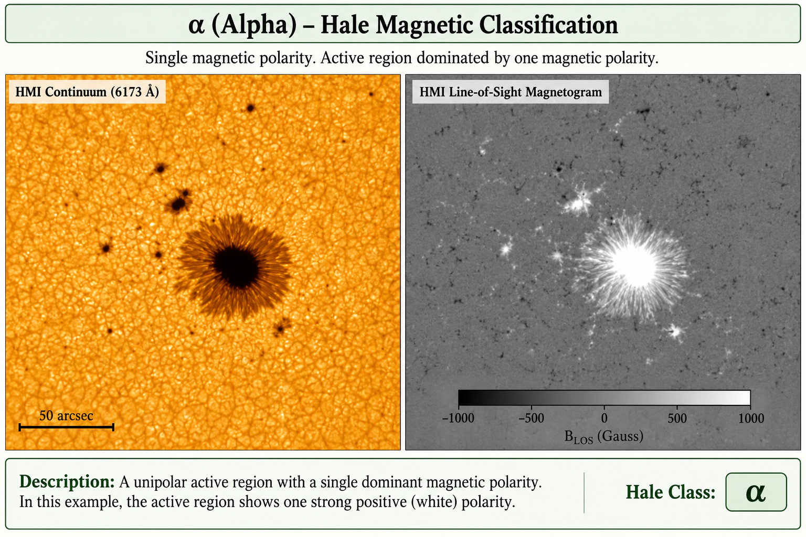
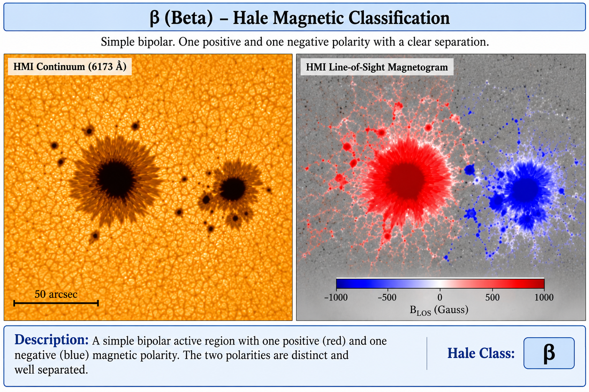
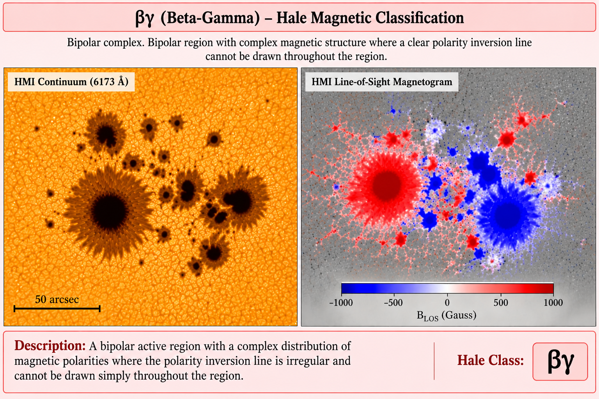
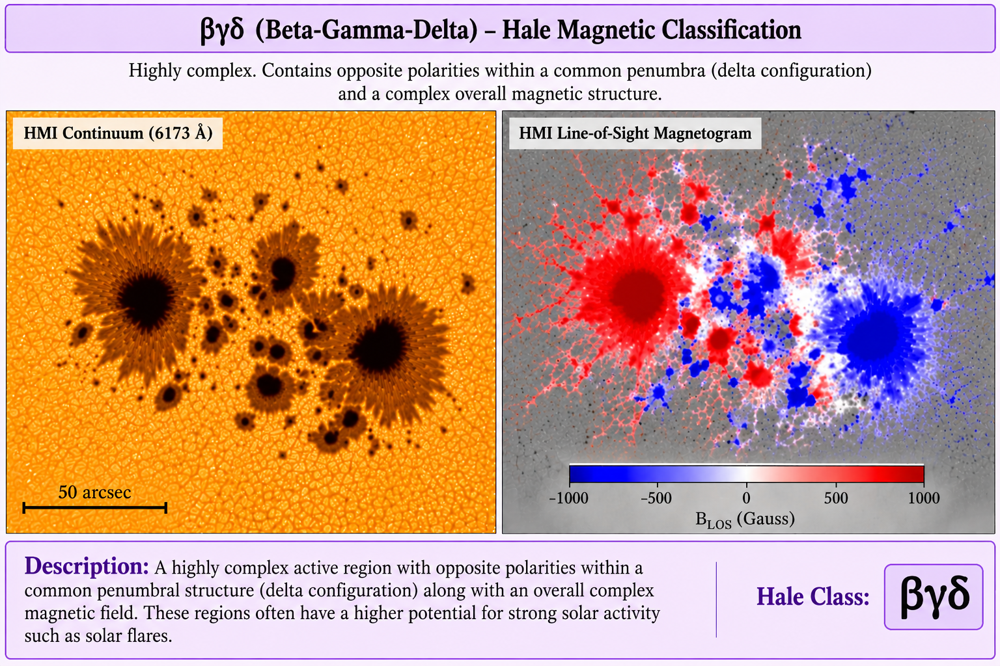

# Solar UV Emission from Active Regions

Analysis of ultraviolet emission from solar active regions and its relationship with magnetic complexity using observations from NASA's Solar Dynamics Observatory (SDO).

---

## 📌 Overview

Solar active regions are areas on the Sun where strong and complex magnetic fields emerge through the photosphere. These regions are often associated with enhanced ultraviolet (UV) emission and solar activity.

This project investigates the relationship between:

- ☀️ Solar active regions
- 🧲 Magnetic field structure
- 🌈 Ultraviolet emission
- 🔬 Hale magnetic classification

The analysis uses data from the **Solar Dynamics Observatory (SDO)**, particularly:

- **HMI (Helioseismic and Magnetic Imager)** — photospheric magnetic-field observations
- **AIA (Atmospheric Imaging Assembly)** — ultraviolet observations at multiple wavelengths
- **NOAA Solar Region Summary (SRS)** reports — active-region information and Hale classifications

---

# 🎯 Objectives

The main objectives of this project are:

1. Identify solar active regions from NOAA SRS reports.
2. Select active regions located near the centre of the solar disk.
3. Obtain corresponding HMI magnetic-field observations.
4. Obtain AIA 1600 Å ultraviolet observations.
5. Crop the observations around the active regions.
6. Align the UV observations with the HMI magnetic-field data.
7. Categorize active regions according to their **Hale magnetic classification**.
8. Investigate how UV emission varies with magnetic complexity.

---

# 🧲 Hale Magnetic Classification

The **Hale magnetic classification** describes the magnetic structure of a solar active region based on the arrangement and complexity of its magnetic polarities.

It is commonly represented using three components:

**α (Alpha)** → A single dominant magnetic polarity.

**β (Beta)** → A bipolar region with a relatively simple magnetic structure.

**γ (Gamma)** → A complex bipolar region in which the polarities are irregularly distributed.

**βγ (Beta-Gamma)** → A bipolar region with complex magnetic structure such that a single polarity inversion line cannot easily be drawn.

**βγδ (Beta-Gamma-Delta)** → A highly complex magnetic configuration containing opposite polarities within a common penumbra. These regions are often associated with strong solar activity.

---

## 📊 Hale Classification

| Classification | Magnetic Structure | Complexity |
|---|---|---|
| **α** | Single polarity | Low |
| **β** | Simple bipolar | Low |
| **βγ** | Complex bipolar | Medium |
| **γ** | Complex magnetic configuration | High |
| **βγδ** | Highly complex bipolar region | Very High |

> **Note:** Hale classification is a qualitative description of magnetic complexity and should not be interpreted as a direct numerical measure of magnetic-field strength.

---

# 🖼️ Hale Classification Examples

The following images illustrate the different magnetic configurations represented by the Hale classification.

### α — Alpha

A region dominated by a single magnetic polarity.



---

### β — Beta

A relatively simple bipolar magnetic region containing distinct positive and negative polarities.



---

### βγ — Beta-Gamma

A bipolar region with a more complex distribution of positive and negative magnetic polarities.



---

### βγδ — Beta-Gamma-Delta

A highly complex magnetic configuration where opposite polarities occur within a common penumbral structure.



---

# ☀️ Data Sources

## Solar Dynamics Observatory

The project uses observations from NASA's **Solar Dynamics Observatory (SDO)**.

### HMI

The **Helioseismic and Magnetic Imager (HMI)** provides measurements of the photospheric magnetic field.

The HMI data are used to study the magnetic structure of the selected active regions.

### AIA

The **Atmospheric Imaging Assembly (AIA)** provides high-resolution images of the solar atmosphere at multiple wavelengths.

This project primarily uses:

**AIA 1600 Å**

to study ultraviolet emission from solar active regions.

---

# 🛰️ Data Processing Pipeline

```text
NOAA SRS Reports
       │
       ▼
Active Region Identification
       │
       ▼
Select Regions Near Disk Centre
       │
       ▼
Hale Classification
       │
       ├───────────────┐
       ▼               ▼
HMI SHARP Data       AIA 1600 Å
       │               │
       ▼               ▼
Magnetic Field       UV Emission
       │               │
       └───────┬───────┘
               ▼
       Region Cropping
               │
               ▼
        Image Alignment
               │
               ▼
      UV–Magnetic Analysis
